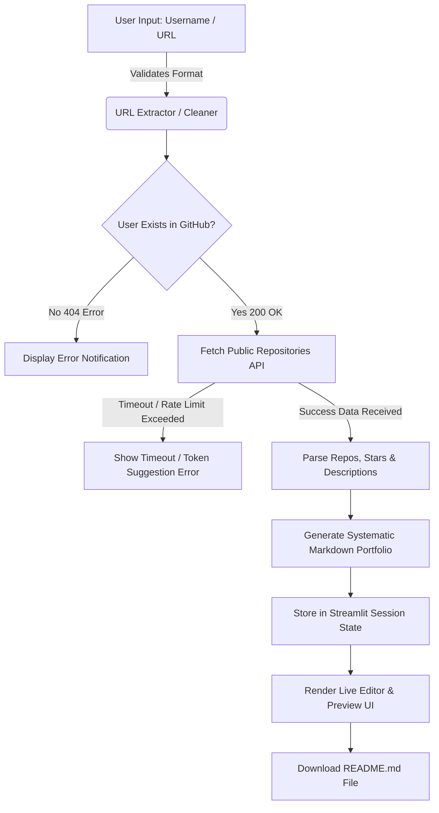

# 🚀 Git2Markdown Pro

[](https://streamlit.io)
[](https://www.python.org/)
[](https://opensource.org/licenses/MIT)
[](CONTRIBUTING.md)
[](https://github.com/yourusername/git-md-generator)

> **Transform any GitHub profile or repository link into a clean, systematic, and professional Portfolio README in seconds!**

---

## 📑 Table of Contents
- [About The Project](#-about-the-project)
- [Key Features](#-key-features)
- [Use Cases](#-use-cases)
- [File Structure](#-file-structure)
- [System Architecture & Diagrams](#-system-architecture--diagrams)
  - [Entity-Relationship (ER) Diagram](#entity-relationship-er-diagram)
  - [Data Flow Diagram (DFD)](#data-flow-diagram-dfd)
- [Installation Guide](#-installation-guide)
- [Setup & Configuration](#-setup--configuration)
- [How to Use](#-how-to-use)
- [Pros and Cons](#-pros-and-cons)
- [Limitations](#-limitation)
- [Future Updates & Roadmap](#-future-updates--roadmap)
- [Contributing](#-contributing)
- [Acknowledgments & Star Us](#-acknowledgments--star-us)

---

## 🌟 About The Project
**Git2Markdown Pro** is a lightweight, high-performance web application built with **Streamlit** and Python. It is designed for developers, students, and open-source enthusiasts who want an automated way to showcase their GitHub contributions, repositories, and technical stats. 

With built-in **multi-language support** (English, Hindi, Spanish, and Latin) without relying on heavy AI APIs, robust timeout handling, and a real-time live Markdown editor with instant preview and download, Git2Markdown Pro bridges the gap between raw GitHub data and a stunning GitHub profile portfolio.

---

## ✨ Key Features
- **Instant Profile Parsing:** Input any valid GitHub username or full repository/profile URL to automatically extract user bio, public repos, and earned stars.
- **Multi-Language Support (Localization):** Fully functional translation dictionary for English, Hindi (हिंदी), Spanish (Español), and Latin (Latina).
- **Interactive Progress Tracker:** Animated step-by-step progress bar (`st.progress`) with status messages for seamless UX.
- **Live Markdown Editor & Preview:** Edit your generated markdown on the fly with a split-screen live preview window.
- **One-Click Download:** Download your customized `README.md` instantly.
- **Optional Token Authentication:** Built-in rate-limit protection via optional GitHub Personal Access Token (PAT).
- **Modern Theme Pack:** Custom Dark-mode UI configured via Streamlit configuration.

---

## 💼 Use Cases
1. **Developer Portfolios:** Quickly generate a professional `README.md` for your main GitHub profile repository (`username/username`).
2. **Resume & Interview Prep:** Summarize a candidate's or your own open-source footprint into a clean tabular markdown format.
3. **Documentation Automation:** Export repository lists for team wikis or academic project submissions.

---

## 📂 File Structure
```text
git-md-generator/
│
├── .streamlit/
│   └── config.toml          # Custom theme & UI color configurations
├── app.py                   # Core application logic & UI components
├── requirements.txt         # Project Python dependencies
└── README.md                # Project documentation

```

---

## 📊 System Architecture & Diagrams

### Entity-Relationship (ER) Diagram

*Illustrating the core entities and state management flow within the application session.*

```mermaid
erDiagram
    USER_INPUT ||--o{ GITHUB_API : requests
    GITHUB_API ||--|{ USER_PROFILE : returns
    GITHUB_API ||--|{ REPOSITORY_LIST : returns
    USER_INPUT {
        string raw_input
        string selected_language
        string optional_token
    }
    GITHUB_API {
        string endpoint_url
        int timeout_limit
        json response_payload
    }
    SESSION_STATE {
        string generated_markdown
        boolean is_verified
    }
    USER_INPUT --> SESSION_STATE : processes
    REPOSITORY_LIST --> SESSION_STATE : formats_into

```

### Data Flow Diagram (DFD - Level 1)

*Tracing how data flows from user input to final markdown generation.*



---

## ⚙️ Installation Guide

Follow these steps to set up the project locally on your machine:

1. **Clone the repository:**
```bash
git clone [https://github.com/alok-kumar8765/git-md-generator.git](https://github.com/alok-kumar8765/git-md-generator.git)
cd git-md-generator

```


2. **Create a virtual environment (Recommended):**
```bash
python -m venv venv
# On Windows:
venv\Scripts\activate
# On macOS/Linux:
source venv/bin/activate

```


3. **Install dependencies:**
```bash
pip install -r requirements.txt

```


---

## 🚀 Setup & Configuration

1. Ensure your `.streamlit/config.toml` file is present for styling:
```toml
[theme]
primaryColor = "#6366f1"
backgroundColor = "#0f172a"
secondaryBackgroundColor = "#1e293b"
textColor = "#f8fafc"
font = "sans serif"

```


2. No API keys are required for basic public usage! (Optional: generate a GitHub Personal Access Token if you plan on running heavy batch requests).

---

## 🖥️ How to Use

1. Run the Streamlit application:
```bash
streamlit run app.py

```


2. Open your browser at `http://localhost:8501`.
3. In the sidebar:
* Select your preferred language (**English**, **Hindi**, **Spanish**, or **Latin**).
* Enter a target GitHub username or profile URL (e.g., `torvalds` or `https://github.com/torvalds`).
* *(Optional)* Provide your GitHub Token if rate limits are reached.


4. Click **Generate Markdown Portfolio**.
5. Edit the markdown in real-time on the left panel, view the live render on the right, and click **Download README.md**!

---

## ⚖️ Pros and Cons

### Pros

* **Zero Frontend Overhead:** Pure Python implementation using Streamlit.
* **Robust Exception Handling:** Prevents app crashes on slow networks or invalid user handles via explicit timeout management.
* **Multi-Lingual:** Accessible to global developers in their native tongues.

### Cons

* **Rate Limiting:** Unauthenticated requests share a global IP rate limit of 60 requests/hour imposed by GitHub.
* **Public Data Only:** Cannot parse private repositories unless a valid Personal Access Token with repo scopes is supplied.

---

## ⚠️ Limitations

* Repositories with extremely large README structures or extensive topic tags may occasionally truncate table descriptions.
* Requires active internet connection to query live GitHub REST endpoints.

---

## 🔮 Future Updates & Roadmap

* [ ] **GitHub OAuth Integration:** Allow one-click direct commit to user repositories.
* [ ] **Database Persistence (SQLite/Supabase):** Save user generation history.
* [ ] **Custom Portfolio Templates:** Choose between Minimalist, Cyberpunk, and Data Scientist layouts.
* [ ] **Sub-Project / Monorepo Scanner:** Deep-scan nested directory structures inside repositories.

---

## 🤝 Contributing

Contributions, issues, and feature requests are welcome!
Feel free to check the [issues page](https://www.google.com/search?q=https://github.com/alok-kumar8765/git-md-generator/issues).

1. Fork the Project
2. Create your Feature Branch (`git checkout -b feature/AmazingFeature`)
3. Commit your Changes (`git commit -m 'Add some AmazingFeature'`)
4. Push to the Branch (`git push origin feature/AmazingFeature`)
5. Open a Pull Request

---

## 🙏 Acknowledgments & Star Us

If this project helped you build a better GitHub profile or saved you time, please give it a **⭐ Star** on GitHub! It helps other developers discover the project.

*Built with ❤️ by [Your Name](https://github.com/alok-kumar8765).*
